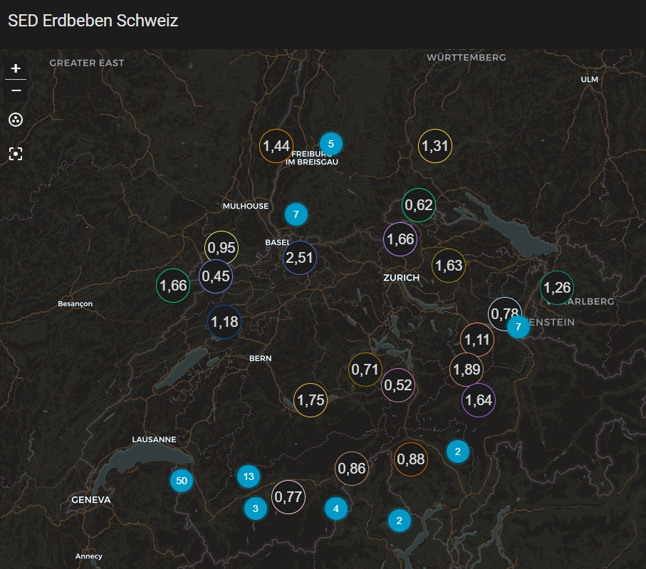

# Swiss Earthquakes (SED)

[](https://github.com/hacs/integration)
[](LICENSE)
<a href="https://www.buymeacoffee.com/prusuino"></a>

A Home Assistant custom integration that shows recent Swiss earthquakes on a map, sourced from the **Swiss Seismological Service (SED, ETH Zurich)**.



## Background

The SED operates a public **FDSN Event Web Service** — the same standardized protocol used by seismological networks worldwide — with no authentication required. This integration queries it for earthquakes within a configurable radius, time window, and minimum magnitude around a location, and turns each one into a `geo_location` entity.

Home Assistant's `geo_location` platform is designed exactly for this: entities with coordinates automatically show up as markers on any Map card — no custom card needed. Entities appear and disappear on their own as new earthquakes occur and old ones age out of the configured time window.

**Note on coverage:** the SED runs its own regional monitoring network (~150 stations) in and around Switzerland. Even with a very large radius configured, you will only see earthquakes from Switzerland and its immediate border regions — that's the actual extent of the SED's own catalog, not a limitation of this integration.

Quarry blasts (which the raw feed also contains) are filtered out server-side (`eventtype=earthquake`).

## What it provides

| Entity | Description |
|---|---|
| `geo_location.sed_earthquake_<event>_<id>` — see [Addressing the map markers](#addressing-the-map-markers) | One per currently tracked earthquake. State = distance from your configured location (km). Attributes: magnitude, magnitude type, depth (km), timestamp, place. Shows up automatically on any Map card; the marker goes unavailable while the SED service is unreachable. |
| `sensor.sed_earthquakes_count_<radius>km_<id>` | Count of earthquakes currently within the configured radius/time window/magnitude threshold. Attribute `strongest_quake` holds the strongest currently tracked event; attribute `magnitude_scale` is a plain-language reference for what different magnitude ranges typically mean (see below). |
| `sensor.sed_earthquakes_latest_<radius>km_<id>` | Timestamp of the most recent earthquake (`device_class: timestamp`) — reliably fires a state-changed trigger whenever a new earthquake appears. Attributes: magnitude, magnitude type, depth, place, distance, event ID. |
| `sensor.sed_earthquakes_latest_summary_<radius>km_<id>` | Human-readable one-line summary of the most recent earthquake: `place · M magnitude · date/time` (localized date format) — ideal for a dashboard tile. Same details as attributes. Use the timestamp sensor above for automation triggers. |

`<radius>` is the entry's radius in km and `<id>` a four-character tag of the entry itself (the last four characters of its config entry id, lower-cased) — `sensor.sed_earthquakes_count_150km_7f3a`. The radius alone does not tell two entries apart, since a second entry at another location may well use the same radius; the tag does, and it stays fixed for the life of the entry. You find it in the entity ids on the entry's device page after setup. `<event>` is the public part of the SED event id (`2026nuuviw` for `smi:ch.ethz.sed/sc25a/Event/2026nuuviw`), so a marker's id is the same in every language and does not change when the SED revises the event. These are the ids suggested when an entity is first created: **entities set up with version 1.4 or earlier keep the ids they already have** (sensors without the tag, markers derived from their localized name such as `geo_location.erdbeben_m2_3_sion_vs`), and any entity can be renamed in its settings at any time.

Data is refreshed every 10 minutes; each refresh asks the SED service for at most 200 events, newest first (see [Notes](#notes)).

### Addressing the map markers

A marker's entity id is built from the SED event id (`geo_location.sed_earthquake_2026nuuviw_7f3a`), so it is the same in every language and survives revisions — but it only exists once the earthquake has happened, so a card or template cannot name markers in advance. Address them by their `source` attribute instead, which is always `sed_earthquakes`. That also covers markers created by versions before 1.5.0, whose ids were derived from the localized name (`geo_location.erdbeben_m2_3_sion_vs` on a German instance, `geo_location.earthquake_m2_3_sion_vs` on an English one) and stay as they are until the earthquake ages out of the time window:

- **Map card** — `geo_location_sources` draws every marker of this integration (also the ones hidden from the auto-generated overview) and follows earthquakes as they appear and age out, and it can put the magnitude on the marker label:

  ```yaml
  type: map
  geo_location_sources:
    - source: sed_earthquakes
      label_mode: attribute
      attribute: magnitude
  ```

- **Templates** — filter the `geo_location` domain on the `source` attribute instead of naming entities:

  ```jinja
  {{ states.geo_location
     | selectattr('attributes.source', 'eq', 'sed_earthquakes')
     | rejectattr('attributes.magnitude', 'none')
     | selectattr('attributes.magnitude', 'ge', 2.5)
     | map(attribute='name') | list }}
  ```

  This lists the tracked earthquakes of magnitude 2.5 or more, in any language.

For a notification on a new earthquake, trigger on `sensor.sed_earthquakes_latest_<radius>km_<id>` instead — its id is fixed, and its attributes carry the details of the event.

## Language

Entity names, the device name/manufacturer/model, the config flow, and the texts of the [dashboard strategy](#dashboard) adapt automatically to your Home Assistant language setting — German, English, French, and Italian are supported, with English as the fallback for any other language.

### Magnitude scale

`sensor.sed_earthquakes_count_<radius>km_<id>` carries a `magnitude_scale` attribute with a rough, SED-sourced orientation of what different magnitudes typically mean in Switzerland (localized to your HA language):

| Magnitude | Typical effect |
|---|---|
| < 2.5 | Not felt, only recorded by seismometers |
| 2.5 – 4.0 | Felt by people near the epicenter, usually no damage |
| 4.0 – 4.5 | Isolated minor damage near the epicenter possible (e.g. cracked plaster) |
| 4.5 – 5.5 | Minor damage to individual buildings likely, rarely more serious damage |
| > 5.5 | Historically rare in Switzerland (e.g. Basel 1356, M~6.6) — can cause significant damage |

This is a rough orientation, not a prediction — actual effects depend heavily on depth, distance to the epicenter, and local subsoil. Source: [SED magnitude FAQ](https://www.seismo.ethz.ch/en/knowledge/faq/what-does-magnitude-mean/).

## Installation

### HACS (recommended)

1. Open **HACS**, search for **"Swiss Earthquakes"** and download it — or use the button, which opens the integration directly in your HACS:

   [](https://my.home-assistant.io/redirect/hacs_repository/?owner=prusuino&repository=ha_swiss_earthquakes&category=integration)

2. Restart Home Assistant.

Until the integration shows up in the HACS search, the button above adds it as a custom repository.

### Manual

1. Copy the `custom_components/sed_earthquakes` folder into your Home Assistant `config/custom_components/` directory.
2. Restart Home Assistant.

## Setup

1. Go to **Settings → Devices & Services → Add Integration**.
2. Search for **"Swiss Earthquakes (SED)"**.
3. Latitude/longitude default to your Home Assistant home location. Set the radius (km), minimum magnitude, and time window (days) to your preference. The coordinates, radius, magnitude and window are sent to the SED service with every query (see [Notes](#notes)); if you would rather not send your exact home location, round the coordinates to two decimals.
4. Submit. The form rejects a radius of 0, a time window under a day and coordinates outside the valid range, and sends one query to the SED service first — an unreachable service shows up here rather than as a failed setup afterwards.
5. Done. Add the integration again for a different location or radius — each instance is independent.
6. Optional: register the [strategy file](#adding-the-strategy-as-a-resource) as a resource and set up the [dashboard](#dashboard). The integration works fully without it — this only saves you building the map card yourself.

## Dashboard

The integration ships a **dashboard strategy**: a recipe Home Assistant renders in the browser, rather than a dashboard written into your configuration. Nothing is stored, nothing is overwritten, and the result follows your setup — add a second location and its section appears on the next page load; remove one and it is gone. It replaces the "Earthquakes Switzerland" dashboard that versions before 1.3.0 created in your Lovelace storage.

The integration deliberately does not create or modify any dashboard on your behalf — your dashboards stay entirely under your own control.

### Adding the strategy as a resource

The integration serves the strategy file, but registering it as a Lovelace resource is left to you — the resource list is part of your dashboard configuration, and an integration has no business writing into it. It is a one-time step:

**Settings → Dashboards → ⋮ (top right) → Resources → + Add resource**

| Field | Value |
|---|---|
| URL | `/sed_earthquakes_files/swiss-earthquakes-dashboard.js` |
| Resource type | JavaScript module |

The *Resources* entry is only shown when **Advanced mode** is enabled in your user profile (click your name at the bottom of the sidebar). Then reload the page (Ctrl/Cmd+Shift+R).

### Using the strategy

1. **Settings → Dashboards → + Add dashboard → New dashboard from scratch**, give it a name.
2. Open it, then **✏️ (edit) → ⋮ → Raw configuration editor**.
3. Replace the entire content with:

```yaml
strategy:
  type: custom:swiss-earthquakes
views: []
```

4. Save.

You get:

- a **Map** view — every tracked earthquake on a full-screen map, each marker labeled with its magnitude (the same map card the integration used to create for you). The view is there even while no earthquake is in the configured time window;
- an **Overview** view — one section per configured location: the earthquake count and the time of the latest event as tiles, plus a text card with the latest and the strongest earthquake of the window (or a note that the SED service is unreachable while it is).

The strategy also appears under **+ Add dashboard** as *Swiss Earthquakes*, which does the same thing without the raw editor.

Everything the strategy produces is a normal Home Assistant dashboard. If you would rather arrange things yourself, [build the map card yourself](#building-the-map-card-yourself) — the strategy is an offer, not a requirement.

### Adjusting the strategy

A strategy dashboard has no card editor — the layout is generated fresh on every load. You still have two ways to shape it without giving that up:

**Options.** Anything you add under `strategy:` is passed to the recipe:

```yaml
strategy:
  type: custom:swiss-earthquakes
  title: My title
  max_columns: 3
views: []
```

| Option | Effect |
|---|---|
| `title` | dashboard title |
| `max_columns` | column count of the generated section views |
| `map: false` | leave out the full-screen map view |

**One view inside your own dashboard.** Instead of a separate dashboard, let the strategy fill a single view of one you already have. Open your dashboard's raw configuration editor and add a view:

```yaml
views:
  - title: Home
    # ... your own cards ...
  - title: Swiss Earthquakes
    strategy:
      type: custom:swiss-earthquakes
```

That view is regenerated like the full dashboard is, so new config entries still appear by themselves, while every other view stays yours to edit. The same options work here too.

> **Take control** (⋮ menu) turns a strategy dashboard into a static one you can edit card by card — but it is one-way: the dashboard stops following your config entries from then on. Prefer the two approaches above.

### Building the map card yourself

Every earthquake becomes a `geo_location` entity, so Home Assistant's **built-in Map card** can display them — no custom card and no extra HACS dependency required. The card can label each marker with the event's magnitude out of the box, via its `label_mode: attribute` option.

To set this up:

1. Open the dashboard you want to use (or create a new one under **Settings → Dashboards → Add dashboard**).
2. Choose **Edit dashboard → Add card → Manual**.
3. Paste the following configuration:

```yaml
type: map
geo_location_sources:
  - source: sed_earthquakes
    label_mode: attribute
    attribute: magnitude
default_zoom: 8
```

> **Note:** the earthquake entities are hidden by default so they don't flood Home Assistant's auto-generated overview map. This only affects entities the first time they are registered; the Map card above and the strategy's map find them regardless, because they select them by source.

## Notes

- Switzerland has continuous low-level background seismicity — with the default settings (150 km, magnitude ≥ 0, 30 days) you'll typically see dozens of entities, mostly very small (M<1) events. Raise the minimum magnitude if you only want noticeable events.
- This integration is unofficial and not affiliated with, endorsed by, or supported by the SED or ETH Zurich. It only reads their published data via the standard FDSN protocol.
- Each refresh asks the SED service for at most 200 events, newest first. With a large radius, a low minimum magnitude and a long time window, a busy period (an earthquake swarm, say) can exceed that: the oldest events of the window are then left out — the count sensor stops at 200 and the oldest markers disappear early. Raise the minimum magnitude or shorten the window if that matters to you.
- What leaves your instance: with every refresh, the configured latitude and longitude, radius, minimum magnitude and time window are sent to `https://eida.ethz.ch/fdsnws/event/1/query` as query parameters over HTTPS — nothing else, and no identifiers. The coordinates default to your home location at full precision; entering them rounded to two decimals (about 1 km) makes no practical difference to the result. See [SECURITY.md](SECURITY.md).
- If the FDSN service is unreachable, the sensors and the map markers become unavailable rather than showing stale data, and come back on the next successful refresh. The log records the HTTP status (or the error type) of the failed request, not its URL.
- A marker whose earthquake has aged out of the time window is removed completely — entity and entity-registry entry — so it does not linger as an unavailable entity. Markers of earthquakes still in the window keep whatever you changed on them (name, visibility, area).

## Data source & license

This integration reads live data from the SED's public FDSN Event Web Service. Citing the source is required whenever this data is displayed — see [NOTICE.md](NOTICE.md) for details. Every entity sets Home Assistant's `attribution` attribute accordingly.

## Disclaimer

This integration is provided **as-is, without any warranty**. Data is retrieved from a third-party published source and may be inaccurate, delayed, incomplete, or unavailable — earthquake parameters (location, time, magnitude) for very recent events are often only automatically determined and can change after manual review by the SED. Do not rely on this integration for safety-critical decisions. The author(s) accept **no responsibility or liability** for any damage, loss, incorrect readings, or other issues arising from using this integration, whether it stops working, behaves unexpectedly, or never worked correctly for your setup in the first place.

## License

Source code: MIT — see [LICENSE](LICENSE). Earthquake data: see [NOTICE.md](NOTICE.md) for the SED's attribution requirement.

## Related integrations

More Home Assistant integrations from the same author:

- [Swiss Waters](https://github.com/prusuino/ha_swiss_waters) — live water temperature, water level, discharge and flood danger levels of Swiss rivers and lakes
- [Swiss Charging Stations](https://github.com/prusuino/ha_swiss_charging_stations) — real-time availability and prices of public EV charging stations in Switzerland
- [Austrian Charging Stations](https://github.com/prusuino/ha_austrian_charging_stations) — real-time availability of public EV charging stations in Austria
- [Swiss Transport](https://github.com/prusuino/ha_swiss_transport) — live public-transport departure boards and saved connections
- [Swiss Parking](https://github.com/prusuino/ha_swiss_parking) — live free parking spaces in Swiss cities
- [Swiss Electricity Price](https://github.com/prusuino/ha_swiss_electricity_price) — electricity tariffs of any Swiss grid operator (ElCom)
- [Swiss Solar Reference Price](https://github.com/prusuino/ha_swiss_solar_reference_price) — the Swiss solar reference market price (SFOE)
- [Swiss Avalanche Bulletin](https://github.com/prusuino/ha_swiss_avalanche_bulletin) — the official SLF avalanche bulletin for your location
- [Swiss Public Alerts](https://github.com/prusuino/ha_swiss_public_alerts) — official Swiss public alerts (Alertswiss) with home-location matching
- [Innoxel Master 3](https://github.com/prusuino/ha_innoxel_master3) — local control of the Innoxel Master 3 home-automation system

## Support

If this integration is useful to you, you can support its development:

<a href="https://www.buymeacoffee.com/prusuino"></a>
